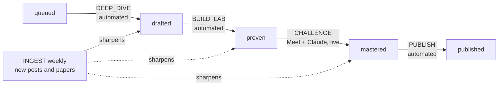

# Architect Playbook: system design as the base of AI-era architecture

> In the AI era, syntax is cheap and architecture is expensive. Production AI systems fail at the
> architecture layer: state, concurrency, backpressure, partial failure, cost runaway, non-deterministic
> tool execution. Those are distributed-systems problems with decades of hard-won answers.

This is a living Single Source of Truth that teaches each classic mechanism through the AI-era problem it
governs, proves it with a runnable failure lab, and ends in a publish-ready deep dive.

**Start here:** [ROADMAP.md](ROADMAP.md) · [STATUS.md](STATUS.md) · [How it runs itself](AUTOMATION.md)

## Who it is for
- **Engineers a bit above basics** who have shipped backend code and want real depth, not interview flashcards.
- **Experienced architects** who want a sharp mapping from battle-tested patterns to LLM and multi-agent failure modes.

## How a concept moves



Each step is one pull request. CI checks every PR: the structure, the depth gates, and that every lab still
proves its failure mode.

## Layout

```
curriculum.toml          registry: 30 concepts, AI question, prerequisites, week, stage
ROADMAP.md  STATUS.md    plan and generated progress
AUTOMATION.md            schedules and how to run it
concepts/m1-storage-and-data/c01-write-ahead-log/
    notes.md  lab/  review.md  post.md
workflows/               WEEKLY DEEP_DIVE BUILD_LAB CHALLENGE PUBLISH INGEST
.claude/commands/        /weekly /deep-dive /build-lab /challenge /publish /ingest
templates/  tools/playbook.py
sources/MASTER_SOURCES.md  sources/feeds.toml  sources/bedrock/ (PDFs gitignored)
inbox/drops.md  inbox/reports/
```

## Modules
0. **Foundations** — the basics everyone skips: latency numbers, threads and races, fsync, TCP, clocks, failure models, queueing, anatomy of an LLM call.
1. **Storage, Data & State** — WAL, B-Trees vs. LSM, partitioning, vector indexes and agent memory.
2. **Distributed Coordination** — clocks, CAP/PACELC, Raft, locks, leases and fencing.
3. **Async Messaging & Backpressure** — queues vs. logs, idempotency, DLQs, durable agent execution.
4. **Reliability & Guardrails** — retries with jitter, circuit breakers, SLOs and token budgets, tracing and evals.
5. **Network, Caching & Edge** — event loops and load balancing, caching and stampedes, semantic/prefix caching and SSE.
6. **Agentic Architecture** — workflows vs. agents, tool contracts and sandboxing, multi-agent orchestration.
