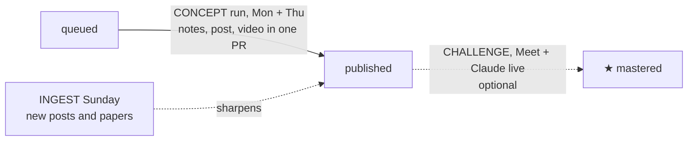

# Architect Playbook: system design as the base of AI-era architecture

> In the AI era, syntax is cheap and architecture is expensive. Production AI systems fail at the
> architecture layer: state, concurrency, backpressure, partial failure, cost runaway, non-deterministic
> tool execution. Those are distributed-systems problems with decades of hard-won answers.

This is a living Single Source of Truth that teaches each classic mechanism through the AI-era problem it
governs, told as a story with real systems and real incidents, and ships each one as a blog post and a
narrated short video. Two concepts a week, in one planned order, fully automated.

**Start here:** [EXPLAINING.md](EXPLAINING.md) · [ROADMAP.md](ROADMAP.md) · [STATUS.md](STATUS.md) · [How it runs itself](AUTOMATION.md)

## Who it is for
- **Engineers a bit above basics** who have shipped backend code and want real depth, not interview flashcards.
- **Experienced architects** who want a sharp mapping from battle-tested patterns to LLM and multi-agent failure modes.

## How a concept moves



`curriculum.toml` holds one ordered list (`seq`): 38 items in 7 tracks, similar concepts together, each
track closing with real-world case studies. Every Monday and Thursday a scheduled run takes the next item
and opens one pull request with its notes, blog post and video. CI checks the structure and depth gates.
You merge, and the next one comes.

## Layout

```
curriculum.toml          registry: 38 items in serial order (seq), tracks, AI question, stage
ROADMAP.md  STATUS.md    plan and generated progress
AUTOMATION.md            schedules and how to run it
concepts/m1-storage-and-data/c01-write-ahead-log/
    notes.md  post.md  video.md  video/  (review.md after /challenge, lab/ optional)
workflows/               WEEKLY CONCEPT DEEP_DIVE PUBLISH CHALLENGE INGEST (BUILD_LAB optional)
.claude/commands/        /weekly /concept /deep-dive /publish /challenge /ingest /build-lab
templates/  tools/playbook.py  tools/video/ (the shared video template and renderer)
sources/MASTER_SOURCES.md  sources/feeds.toml  sources/bedrock/ (PDFs gitignored)
inbox/drops.md  inbox/reports/
```

## Modules (where files live; the teaching order is the tracks in ROADMAP.md)
0. **Foundations** — the basics everyone skips: latency numbers, threads and races, fsync, TCP, clocks, failure models, queueing, anatomy of an LLM call.
1. **Storage, Data & State** — WAL, B-Trees vs. LSM, partitioning, vector indexes and agent memory.
2. **Distributed Coordination** — clocks, CAP/PACELC, Raft, locks, leases and fencing.
3. **Async Messaging & Backpressure** — queues vs. logs, idempotency, DLQs, durable agent execution.
4. **Reliability & Guardrails** — retries with jitter, circuit breakers, SLOs and token budgets, tracing and evals.
5. **Network, Caching & Edge** — event loops and load balancing, caching and stampedes, semantic/prefix caching and SSE.
6. **Agentic Architecture** — workflows vs. agents, tool contracts and sandboxing, multi-agent orchestration.
7. **Case studies** — one per track: real systems and outages that use everything the track taught.
