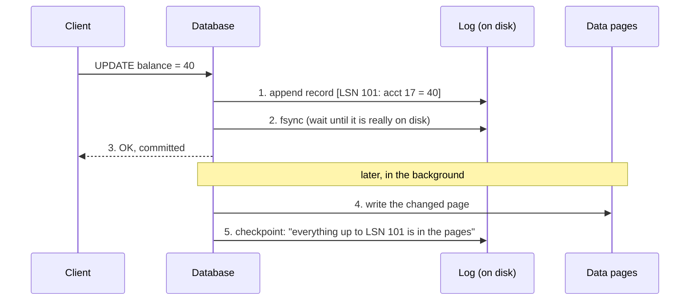

# c01 · Write-Ahead Logs (WAL) & Crash Recovery

> **Reader baseline:** you have shipped backend code. You know HTTP, a SQL database, threads, and what a
> process crash is. Everything beyond that is defined the first time it appears.
>
> **Builds on:** [c24 The Durability Path](../../m0-foundations/c24-page-cache-fsync-durability/notes.md)
> (written later on the roadmap; the one fact you need from it is in part 3, step 3).

Every concept page uses the same eight parts in the same order, so you always know where to look.
Parts 1–8 are the explanation. *Going deeper* is for the second read.

## 1. The AI problem it prevents

A support agent handles a refund in four steps. It asks the LLM to plan the refund, calls the payment API
to refund $40, emails the customer, then asks the LLM for a summary for the ticket. On step 2 the payment
API takes 8 seconds to answer. During those 8 seconds the Kubernetes pod running the agent is evicted.
The refund went through at the bank, but the agent never heard back.

The pod restarts and the orchestrator re-runs the task. The agent has no memory of what it did, so it
starts from step 1. It pays for the planning call again and refunds the customer a second time. Nothing
crashed loudly, nothing was logged as an error, and the company is out $40. At ten thousand runs a day, a
rare eviction becomes a steady leak of money and of trust.

This is an old problem. A database that crashes halfway through a write faces exactly the same question:
*after a restart, how do I know what already happened?* Databases solved it in the 1970s and 80s with a
**write-ahead log**: before you change anything, append a description of the change to a log and make
sure the log is on disk. After a crash, the log is the truth.

## 2. Intuition

Think of a bank teller with a paper ledger book, decades before computers. The teller never changes an
account balance first. They write the transaction in the journal ("10:42, account 17, deposit $40"), and
only then update the account card. If the teller faints halfway through updating the card, the next
teller reads the journal and finishes the job. The account cards can always be rebuilt from the journal.
The journal is only ever appended to, never erased: mistakes are fixed by writing a new, correcting line.

Three properties of the journal carry over exactly to software:

- **Write the intent first.** The journal entry exists *before* the real change happens.
- **Append only.** You never overwrite an old entry, so a crash can only damage the entry being written,
  never the history before it.
- **The journal is the truth.** Everything else (account cards, database pages, an agent's in-memory
  state) is a convenient copy that can be rebuilt from the journal.

The analogy breaks down in one important place: paper does not lie about whether the ink is dry. A
computer does. When a program "writes" to a file, the bytes usually sit in memory for a while before they
reach the disk. Part 3 is mostly about how a WAL forces the ink to dry before it says "saved".



## 3. Mechanics, step by step

Follow one write, `UPDATE accounts SET balance = 40 WHERE id = 17`, through a WAL-based database.

1. **Build a log record.** The database describes the change as a small record: a header and a payload.
   The header holds the payload length, a **checksum** (a short number computed from the payload bytes,
   such as a CRC32, which changes if any byte changes), and a **log sequence number (LSN)**. The LSN is a
   counter that only goes up, usually the byte offset of the record in the log. The payload says what
   changed: "page 912, offset 40, new bytes …", or at a higher level, "account 17 = 40".

2. **Append it to the end of the log file.** The log is one file (or a series of fixed-size segment
   files) that is only ever appended to. Appending is a *sequential* write: the disk writes the next bytes
   right after the last ones, with no seeking. That makes it the cheapest kind of write a storage device
   can do, which is why the log can keep up even when the data pages are scattered all over the disk.

3. **Force it to stable storage with `fsync`.** This is the step that makes the whole thing work, and the
   one people get wrong. When a program calls `write()`, the operating system copies the bytes into the
   **page cache**, an area of RAM, and returns immediately. The bytes are not on the disk yet. If the
   power fails now, they are gone. `fsync(fd)` asks the kernel to push that file's cached data to the
   device and to tell the device to flush its own volatile cache. It returns only when the data is
   durable. Durability is defined by this moment, not by `write()` returning.

4. **Acknowledge the commit.** Only after `fsync` returns does the database tell the client "committed".
   This ordering is the contract: *log record durable → then ack*. Break it and you get a database that
   says "saved" and then forgets.

5. **Apply the change to the data pages, lazily.** The database also updates the page in its memory
   buffer (the copy of the on-disk page that it keeps in RAM). That page is now **dirty**: newer in
   memory than on disk. It does *not* need to be written at commit time, because the log already holds
   everything needed to redo the change. This is called a **no-force** policy: commits don't force data
   pages to disk. Dirty pages are written later, in the background, in big efficient batches.

6. **Checkpoint.** Periodically the database writes all dirty pages up to some LSN to disk and records
   "pages are up to date through LSN 101" in a checkpoint record. Log segments before that point are no
   longer needed for crash recovery and can be recycled. Checkpoints keep the log from growing forever
   and bound how long recovery takes.

7. **Recover after a crash.** On restart the database finds the last checkpoint and reads the log forward
   from there, **redoing** every record onto the pages. For each record it checks the length and the
   checksum. The first record that is cut short, or whose checksum does not match, marks the end of the
   valid log. That record was being written when the power failed, so it was never acknowledged. The
   database discards that **torn tail** and starts accepting writes again.

Two refinements show up in every real system:

- **Group commit.** One `fsync` per transaction caps a database at a few hundred to a few thousand commits
  per second, depending on the device. So databases batch: transactions that arrive while one `fsync` is
  in flight wait a moment and are made durable together by the next one. Each commit waits slightly
  longer and throughput rises a lot. The exact numbers depend heavily on the device and on whether its
  cache is protected against power loss. Measure them on your machine (lab extension 1) rather than
  trusting a blog post.
- **Redo vs. undo.** The steps above describe a **redo log**: it records new values so committed work can
  be replayed. Some systems also let uncommitted dirty pages reach the disk early (a **steal** policy),
  which means recovery must also *undo* changes from transactions that never committed. That needs undo
  information too. The ARIES algorithm (Mohan et al., 1992) is the classic design that supports both
  steal and no-force with one log. Most modern databases descend from it.

## 4. Break it

How a WAL-based system fails, and what each failure looks like:

| Failure | Trigger | What happens | What the user sees | How you detect it |
|---|---|---|---|---|
| **Torn write** | Power loss in the middle of appending a record | Last record is partial | Nothing, if recovery truncates the torn tail correctly | Recovery log line: "discarded N tail bytes" |
| **Ack before durable** | Code acks after `write()` but before `fsync`, or `fsync` is turned off for speed | Acked writes live only in RAM | Committed data disappears after a crash | Crash tests only; it is invisible in normal operation |
| **Lying device** | Drive or virtual disk acknowledges a flush it did not perform (volatile cache with no power-loss protection) | Same as above, below the OS | Same as above, even with "correct" code | Pull-the-plug testing; check device cache settings |
| **fsync error mishandled** | Disk I/O error during writeback; app retries `fsync` and assumes success | On Linux the failed dirty pages may be dropped, so the retry "succeeds" with nothing written | Silent data loss or corruption | Treat any `fsync` error as fatal; crash and recover from the log (see part 5) |
| **Corruption mid-log** | Bit rot or a bad sector in an *old* record | Checksum fails in the middle of the log, not at the tail | Recovery stops early, so later committed data is missing | Distinguish "bad tail" (normal) from "bad middle" (alarm, restore from replica or backup) |
| **Log outgrows checkpoints** | Checkpoints too rare, or old log kept for a lagging replica | Disk fills; recovery takes very long | Outage, slow restarts | Monitor log size, replica lag, time since last checkpoint |

**The lab** ([lab/README.md](lab/README.md)) makes the first two failures happen in front of you. A fake
disk loses power after byte *N*, and the test sweeps *N* over every byte of a 7-write workload.

```
naive: 634 of 664 crash points lose acked data; worst: crash at byte 514 loses 6 of 6 acked keys
wal:   0 of 230 crash points lose acked data
```

The naive store rewrites its whole state file in place: `truncate` the file, then write the new
contents. In the gap between those two lines, the old state is gone and the new state is incomplete.
Nearly every byte of the workload falls in that gap, so 634 of 664 crash points lose data the client was
told was saved, and the worst one loses everything. The WAL store only ever appends
`[length][crc32][payload]` and replays on restart, so a crash can only ever cost the one write that was
never acknowledged. The lesson lives in two places in the code: `NaiveStore.set` (destroy, then write)
and the length and checksum check in `WalStore._recover` (trust nothing you cannot verify).

## 5. Real incidents

**PostgreSQL and "fsyncgate" (2018).** Craig Ringer reported on the PostgreSQL mailing list that
PostgreSQL could silently lose data after a storage error. PostgreSQL, like most software, assumed that if
`fsync` failed it could simply call `fsync` again later, and a success meant the data was safe. On Linux
that assumption was wrong. When writeback of dirty pages fails, the kernel reports the error once,
can mark the pages clean and drop them, and a later `fsync` returns success even though the data never
reached the disk. A database could therefore checkpoint, recycle the WAL that described those changes,
and lose them for good. The mechanism that failed is step 3: the durability point was not where everyone
believed it was. The fix was blunt and correct: PostgreSQL now **panics on `fsync` failure** and recovers
from the WAL, which is still intact, instead of retrying (the `data_sync_retry` setting, off by default).
Kernel developers also discussed and adjusted how writeback errors are reported to applications. A 2020 study by Rebello et al. showed the same
class of bug in other storage systems too.
([LWN: PostgreSQL's fsync() surprise](https://lwn.net/Articles/752063/),
[Rebello et al., USENIX ATC 2020](https://www.usenix.org/conference/atc20/presentation/rebello))

**GitLab.com database outage (January 31, 2017).** GitLab's PostgreSQL replica had fallen behind under
load. A replica stays in sync by streaming the primary's WAL. The primary keeps only a limited number of
old WAL segments, and the replica needed segments the primary had already recycled, so replication could
not resume. Engineers had to re-seed the replica from scratch. While doing that, an engineer ran a
command to wipe the replica's data directory on the wrong server, the primary. About 300 GB of production
data was deleted. Then the backups turned out not to work: the regular database dumps had been failing
silently. GitLab restored from a copy made about six hours earlier and lost about six hours of data. Two
WAL lessons are in this story. First, WAL retention is a capacity decision with real consequences: too
little and a lagging replica cannot catch up; too much and the disk fills. Second, a WAL only protects
you if it is archived somewhere you can actually restore from. GitLab's postmortem committed to
tested restores and point-in-time recovery from archived WAL.
([GitLab postmortem](https://about.gitlab.com/blog/2017/02/10/postmortem-of-database-outage-of-january-31/))

**Worth knowing:** Pillai et al. (OSDI 2014) built a tool that explores every legal ordering of a
program's file writes after a crash. They found crash-consistency bugs in mature systems including
SQLite, LevelDB, Git, and Mercurial. Most bugs came from incorrect assumptions about which writes the
file system keeps in order. Getting a WAL right is hard even for experts, which is why the lab tests
every crash point instead of a few.
([Pillai et al., All File Systems Are Not Created Equal](https://www.usenix.org/conference/osdi14/technical-sessions/presentation/pillai))

## 6. Tradeoffs and where it is used

**What you pay:**

- **Write amplification.** Every change is written at least twice: once to the log and once to the data
  pages. Some systems write it a third time to survive torn pages: PostgreSQL logs a full copy of a page
  the first time it changes after a checkpoint, and MySQL InnoDB has a doublewrite buffer.
- **Commit latency vs. throughput.** Waiting for `fsync` on every commit is the safe default and the main
  cost. Group commit trades a little latency per commit for much more throughput. Turning `fsync` off
  trades safety for speed, and that is only acceptable when the data can be rebuilt from somewhere else.
- **Recovery time vs. checkpoint cost.** Frequent checkpoints mean short recovery but bursts of page
  writes that compete with live traffic. Rare checkpoints mean smooth I/O but long restarts and a big log.

**Alternatives, and when each wins:**

| Approach | How it stays crash-safe | Wins when | Used by |
|---|---|---|---|
| Write-ahead (redo) log | Append the change, fsync, apply later | General purpose; many small writes | PostgreSQL, SQLite in WAL mode, etcd |
| Rollback (undo) journal | Copy the *old* pages aside, then overwrite in place; on crash, copy them back | Simple single-writer embedded use | SQLite's default rollback journal |
| Copy-on-write (shadow paging) | Never overwrite: write new pages elsewhere, then atomically switch one root pointer | Read-heavy workloads; instant crash recovery | LMDB, ZFS, Btrfs |
| The log *is* the database | Data is only ever appended; old data is compacted later | Write-heavy workloads; streams | LSM-tree stores (c02), Kafka |
| Replicate instead of fsync | Ack once N machines hold the write, even only in memory | Machine failures are independent and fast failover matters | Kafka (by default it relies on replication rather than fsync per message) |

**Where you meet it:** every mainstream relational database (PostgreSQL WAL, MySQL InnoDB redo log, SQL
Server transaction log), embedded stores (SQLite WAL mode), consensus systems (the Raft log in etcd is a
WAL, c07), message logs (Kafka, c09), and durable workflow engines (Temporal records each workflow's event
history and replays it, c12).

**The wrong tool:** data you can cheaply recompute or afford to lose, such as caches, derived indexes you
can rebuild, or rate-limit counters. A WAL there adds write cost and operational surface for no benefit.
It is also the wrong *level* for some problems: a WAL makes one machine crash-safe, but it does not by
itself survive losing the machine. That takes replication (c06, c07) or archiving the log off the machine.

## 7. Apply it to agents

The refund agent from part 1 needs a **step journal**: a WAL whose records describe agent steps instead
of page changes. The [lab's `agent_journal.py`](lab/agent_journal.py) builds exactly this, on top of the
same `WalStore`.

**Records.** Two per step, appended to an append-only journal (a WAL file, or a table that is only ever
inserted into, in a database that is itself WAL-protected):

```
intent  {run_id, step: 1, name: "refund", idempotency_key: "run-42:1", input_hash}
done    {run_id, step: 1, result: {"refund_id": "rf_881"}, tokens_used, finished_at}
```

**Write order** (the same contract as part 3):

1. Append `intent` and make it durable.
2. Perform the step: the LLM call or the tool call, passing `idempotency_key` to any tool with side effects.
3. Append `done` with the **result**, and make it durable.
4. Only then move on to the next step.

**On restart**, read the journal for the run:

- A step with a `done` record is **not re-executed**. Its recorded result is fed into the next step. This
  matters twice over for LLM steps: you don't pay for the call again, and you get the *same* output. An LLM
  re-asked the same question can answer differently and send the run down a different path.
- A step with an `intent` but no `done` *may or may not* have happened. That is the honest state after a
  crash. Re-run it with the **same idempotency key**. A payment API that supports keys answers "already
  done, here is the refund id" instead of refunding again. (Why this works, and what to do for tools that
  don't support keys, is concept c10.)
- A step with no records hasn't started. Run it normally.

**What the lab proves:** crashed right after the refund, the naive agent ends with `refunds=2
llm_calls=3`. The journaled agent ends with `refunds=1 llm_calls=2` at every crash point. A third test
removes the idempotency key and shows the in-flight refund happening twice even *with* the journal. The
journal tells you what *might* have happened. Only the system on the other side can tell you what *did*.

**Checkpoints for agents.** A long-running agent's journal grows with every step. The agent equivalent of
a checkpoint is a **state snapshot**: write the agent's full working state (plan, memory, summarized
context) as one record, then the steps before it are no longer needed to resume. Context compaction in a
long conversation is the same tradeoff as checkpoint frequency in part 6: recover faster and store less,
at the cost of work done at snapshot time.

**Where this already exists:** durable-execution engines such as Temporal record each workflow's event
history (activities scheduled, results returned) and rebuild state by replaying it. Agent frameworks such
as LangGraph persist a checkpoint of graph state after each step so a run can resume. Both are this
design. Knowing the WAL underneath lets you judge them: where is the durability point, what is recorded
(the command or the result), and what happens to an in-flight side effect.

## 8. Check yourself

1. A program calls `write()` on its log file, gets success, and acknowledges the client. The machine loses
   power one second later. Is the write safe? Why or why not?
2. Why is appending to a log cheaper than updating data pages in place, even though the WAL writes
   everything twice?
3. During recovery, the 3rd-from-last record fails its checksum, but the last two records are valid. What
   should the database do, and why is this different from a torn tail?
4. What does a checkpoint buy you, and what does it cost?
5. PostgreSQL chose to crash on an `fsync` error instead of retrying. Why is crashing the *safer* choice?
6. In the agent journal, why record the LLM's *output* rather than just "step 1 called the LLM with prompt
   P"?
7. The agent crashed after writing `intent` for the refund step but before writing `done`. List
   everything you can and cannot conclude about the refund.

<details>
<summary>Answers</summary>

1. No. `write()` only copies the bytes into the OS page cache, in RAM. Without `fsync` (and a device that
   honours flushes) the bytes can be lost, so the acknowledgment was a lie.
2. Appends are sequential: no seeking, large contiguous writes, and they can be batched with group commit.
   Data-page writes are scattered and can be deferred and batched in the background. The log turns many
   random writes on the commit path into one sequential write.
3. Corruption in the middle of the log means *committed and acknowledged* data is damaged. That is an
   integrity failure, not a normal crash artifact, and the right response is to stop and raise an alarm
   (restore from a replica or archive). A torn tail is expected after a crash and only affects
   unacknowledged data, so it is safe to discard.
4. It bounds recovery time and lets old log segments be recycled. It costs a burst of page writes, and if
   it is rare, a big log and long restarts.
5. After a failed `fsync`, the kernel may have dropped the dirty pages, so retrying can report success
   without the data ever reaching the disk. The WAL still holds the changes. Crashing and replaying the
   WAL rebuilds the pages from a source you can trust.
6. Re-running a non-deterministic step can produce a different result, which changes the rest of the run,
   and it costs money again. Recording the result (physical logging) makes replay deterministic and free.
7. You know the agent decided to refund with key `run-42:1`. You do not know whether the payment API
   received the request, processed it, or failed. The only safe action is to retry with the same key, or
   query the API by key, and let the payment system's record decide.

</details>

**Design challenge (bring to `/challenge c01`):** design the step journal for a coding agent that edits
files in a repo, runs tests, and opens a pull request. File edits are local and can be redone, test runs
are slow but harmless, and "open PR" is an external side effect with no idempotency key. Where does each
step's durability point go, what exactly do you record, and how do you make "open PR" safe to retry?

## Going deeper

### Veteran's corner

Databases mostly log **commands or page changes and re-execute them on replay**, because their operations
are deterministic: applying "set page 912 offset 40 to these bytes" twice gives the same page. Agent
runtimes cannot rely on that, because LLM calls and most external tools are not deterministic or not
safe to repeat. So the agent journal must log **results**, not commands, for every non-deterministic or
side-effecting step. This is the old distinction between *logical* and *physical* logging, reappearing in
a new place. It is also why durable-execution engines demand that workflow code itself is deterministic
and push every non-deterministic action into a recorded activity. If you see an agent framework that
"resumes" by re-running the prompt, you now know exactly what is wrong with it.

A second, smaller trap: creating a new log segment file and calling `fsync` on it is not enough. The
file's *name* lives in the parent directory, and the directory entry must be made durable too, by calling
`fsync` on the directory. Crash-consistency studies keep finding this bug.

### Open questions

- How do managed cloud databases and network block storage define the durability point? Look for vendor
  docs or papers that say what an acknowledged write survives.
- Cost model of agent checkpointing: at what step count or token count does snapshotting beat replaying?
  Look for published numbers from durable-execution or agent-framework teams in future INGEST runs.

### Self-review

- *Attack:* "fsyncgate is described as Linux silently losing data; is that fair to the kernel?"
  *Resolution:* reworded to describe the error-reporting semantics accurately (errors reported once,
  pages may be dropped). The application's assumption that retrying is safe is the root cause, and the
  kernel change is mentioned.
- *Attack:* "Group commit numbers are uncited." *Resolution:* removed specific figures and pointed to lab
  extension 1 to measure on real hardware.
- *Attack:* "The agent journal claims exactly-once refunds." *Resolution:* the page now says the journal
  only gives *at most one in-flight uncertainty*, and that exactly-once effects need the downstream
  idempotency key. The lab includes a test proving the journal alone is not enough.

## Sources

- [OSTEP ch. 42: Crash Consistency: FSCK and Journaling](https://pages.cs.wisc.edu/~remzi/OSTEP/file-journaling.pdf), Arpaci-Dusseau, 2018. Bedrock for parts 2–4.
- [SQLite: Write-Ahead Logging](https://www.sqlite.org/wal.html) and [Atomic Commit in SQLite](https://www.sqlite.org/atomiccommit.html), SQLite docs. Rollback journal vs. WAL mode.
- [PostgreSQL docs: Reliability and the Write-Ahead Log](https://www.postgresql.org/docs/current/wal-intro.html), PostgreSQL Global Development Group. Full-page writes, checkpoints.
- Mohan et al., *ARIES: A Transaction Recovery Method Supporting Fine-Granularity Locking and Partial Rollbacks Using Write-Ahead Logging*, ACM TODS, 1992. Steal/no-force, redo/undo.
- [LWN: PostgreSQL's fsync() surprise](https://lwn.net/Articles/752063/), Jonathan Corbet, 2018. Incident 1.
- [Rebello et al., Can Applications Recover from fsync Failures?](https://www.usenix.org/conference/atc20/presentation/rebello), USENIX ATC 2020.
- [GitLab: Postmortem of database outage of January 31](https://about.gitlab.com/blog/2017/02/10/postmortem-of-database-outage-of-january-31/), GitLab, 2017. Incident 2.
- [Pillai et al., All File Systems Are Not Created Equal](https://www.usenix.org/conference/osdi14/technical-sessions/presentation/pillai), OSDI 2014.
- [Anthropic, Building Effective Agents](https://www.anthropic.com/research/building-effective-agents), 2024. Agent workflow patterns for part 7.
