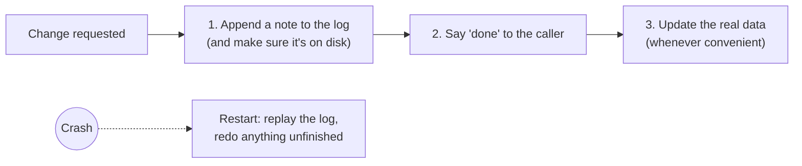
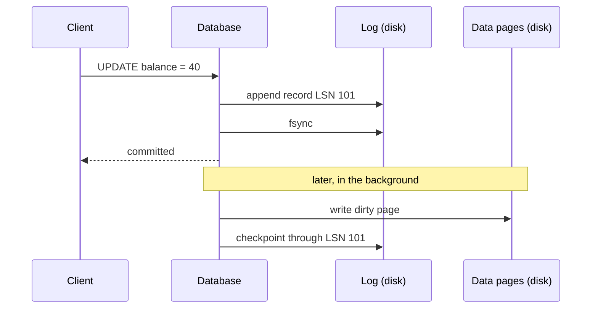

# c01 · Write-Ahead Logs (WAL) & Crash Recovery

> **Builds on:** [c24 The Durability Path](../../m0-foundations/c24-page-cache-fsync-durability/notes.md)
> (later on the roadmap; everything you need from it is explained in part 3).
> **The AI-era question:** an agent crashes on step 2 of 4. How does it resume without redoing paid LLM
> calls or side effects?

**Level 1 · The idea**

## 1. A moment you've lived

You're typing in a document when the laptop dies. You plug it back in, reopen the app, and either your
last paragraph is there or it isn't. If it is, something wrote down what you were doing *before* the
crash, somewhere that survived it.

Now the AI version. A support agent handles a refund in four steps. It asks an LLM to plan, calls the
payment API to refund $40, emails the customer, and asks the LLM for a summary. The payment API takes
eight seconds to reply. During those eight seconds, the pod running the agent is evicted. The bank
processes the refund, but the agent never hears back. The task is retried, the agent remembers nothing,
and it starts again from step one. It pays for the planning call again and **refunds the customer a
second time**. Nothing logs an error.

Both stories ask the same question: **after a crash, how does a program know what it had already done?**
Databases have answered it the same way since the 1970s and 80s. By the end of this page you'll be able to
design that answer yourself.

## 2. The big idea

> **Before you change anything, write down what you're about to do, at the end of a file you only ever
> add to. After a crash, read that file and finish the job.**

That file is the **write-ahead log** (WAL). "Write-ahead" means the note is written *ahead of* the change
itself.



**Analogy.** A bank teller before computers never changed an account card first. They wrote the
transaction in a journal ("10:42, account 17, +$40") and then updated the card. If they fainted halfway,
the next teller read the journal and finished the job. The cards could always be rebuilt from the
journal. *Where the analogy stops working:* ink on paper is visibly dry. A computer can tell you a write
finished when the data is still only in memory. Part 3 shows why that matters.

## 3. Invent it yourself

Your job: build a tiny key-value store (`set("user:17", "$40")`) whose data survives a crash, including
a power cut in the middle of a write. Here are four attempts.

**Try 1: keep everything in memory and save to a file on shutdown.** It's fast and simple.

<details><summary>What happens if the power fails?</summary>

Everything since the last clean shutdown is gone. A crash is, by definition, not a clean shutdown.
</details>

**Try 2: rewrite the whole file on every change.** Open the file, truncate it to empty, write the full
new state. Now every change reaches the disk.

<details><summary>What happens if the power fails halfway through writing?</summary>

You lose **everything**, not just the last change. The moment you truncated, the old state was gone, and
the new state is only half written, so the file is now unreadable. Simulate every possible crash
moment over seven writes and this store loses data it had already confirmed at **634 of 664** of them. It is
also slow: changing one value in a 1 GB store means rewriting 1 GB.
</details>

**Try 3: write the new state to a temporary file, then rename it over the old one.** A rename is atomic
on most file systems: after a crash you see either the old file or the new one, never half of each. That
fixes the corruption. Many tools save config files exactly this way.

<details><summary>So why don't databases do this?</summary>

Every change still rewrites the whole state, so it's still 1 GB of writing to change one value. Safe, but
far too slow for a database taking thousands of changes a second.
</details>

**Try 4: write only the change, appended to the end of a log file.** `set user:17 $40` becomes one short
line added to the end. On restart, read the log from the top and replay each line to rebuild the state.

- It's fast, because it writes a few bytes instead of the whole state, always at the end of the file. That
  is the cheapest kind of write a disk can do.
- It's safe, because old lines are never touched. A crash can only damage the line being written. If the
  last line is incomplete, it was never confirmed, so skip it.

This is the write-ahead log. Two problems remain, and fixing them completes the real design:

- **The log grows forever.** Fix: every so often, save a full snapshot of the state, a **checkpoint**,
  and delete the log lines before it.
- **"Written" can be a lie.** When a program writes to a file, the operating system usually keeps the
  bytes in memory (the **page cache**) and writes them to disk later. If the power fails first, they're
  gone, even though the write "succeeded". Fix: call **`fsync`**, which waits until the bytes are really
  on the disk, and only *then* tell the caller "saved".

So how does a real database put these pieces together?

## 4. You've already used it

- **Your phone.** Most apps store data in SQLite, and Apple's and Android's database libraries switch on
  SQLite's WAL mode by default. Every message you send or note you save goes through a write-ahead log.
- **Your bank statement.** Your balance is a number derived from a list of transactions that is only ever
  appended to. Banks fix mistakes by adding a reversing entry, never by erasing a line.
- **Redis.** With its append-only file (AOF) enabled, Redis logs every write command. Its default fsync
  setting is once per second, so you are explicitly choosing to risk up to about a second of writes for
  speed. The tradeoff is a config line you can read.
- **PostgreSQL and MySQL.** Every commit is a WAL record first. PostgreSQL's replicas copy the primary by
  streaming its WAL.
- **Kafka.** It turned the log itself into the product: a durable, replayable log that many services read.
- **AI agent frameworks.** Temporal records each workflow's event history and replays it after a crash.
  LangGraph saves a checkpoint after each step so a run can resume. Both are write-ahead logs for agents.

**Level 2 · How it really works**

## 5. How it really works

Follow one write, `UPDATE accounts SET balance = 40 WHERE id = 17`, through a WAL-based database. Each
step is a piece you invented in part 3.

1. **Build a log record** (Try 4's "one short line"). The record has a header holding the payload
   length, a **checksum** (a short number computed from the bytes, such as a CRC32, which changes if any
   byte changes), and a **log sequence number (LSN)**, an ever-increasing position in the log. The payload
   describes the change, either physically ("page 912, offset 40, these bytes") or logically ("account 17
   = 40").
2. **Append it** to the end of the log, which is a file or a series of fixed-size segment files.
   Appending is sequential, which is why the log keeps up even when the data itself is scattered all over
   the disk.
3. **`fsync` the log** (the fix for "written can be a lie"). `write()` copied the bytes into the page
   cache. `fsync` pushes them to the device, tells the device to flush its own cache, and returns only
   when the data is durable.
4. **Acknowledge the commit.** The ordering is the whole contract: *log record durable → then "committed"*.
5. **Apply the change to the data pages, lazily.** The database updates its in-memory copy of the page,
   which is now **dirty** (newer than the disk). It doesn't have to write that page at commit time,
   because the log can redo it. This is the **no-force** policy, and it's why commits are fast.
6. **Checkpoint** (the fix for "the log grows forever"). Periodically, write the dirty pages and record
   "pages are current through LSN N". Log segments before N can be recycled.
7. **Recover after a crash.** Start at the last checkpoint and redo every record. Check each one's length
   and checksum. The first record that is cut short or fails its checksum is the **torn tail**, a write
   that was never acknowledged. Discard it and resume.



Two refinements appear in every serious system:

- **Group commit.** One `fsync` per commit caps throughput at however many flushes the device can do per
  second. So the database lets transactions that arrive during one `fsync` share the next one: each waits a
  moment longer, and throughput rises sharply. The exact numbers depend on the device and on whether its
  cache survives power loss, so measure them on your machine rather than trusting a blog post.
- **Undo as well as redo.** Some databases let uncommitted dirty pages reach the disk early (a **steal**
  policy) to free memory. Then recovery must also *undo* changes from transactions that never committed.
  ARIES (Mohan et al., 1992) is the classic algorithm that supports both, and most databases descend from
  it.

<details><summary>Predict: after a crash, the 3rd-from-last record fails its checksum, but the last two records look fine. Is that a torn tail?</summary>

No. A torn tail is always at the *end*. Corruption in the middle means a record that was already
acknowledged is damaged: bit rot, a bad sector, a bug. The database should stop and raise an alarm
(restore from a replica or archive), not quietly discard everything after it.
</details>

## 6. When it goes wrong

**PostgreSQL's "fsyncgate" (2018): the durability point wasn't where everyone thought.** PostgreSQL, like
most software, assumed that if `fsync` failed it could call `fsync` again later, and a success meant the
data was safe. Craig Ringer showed that on Linux this was false. When the kernel fails to write dirty pages
to disk, it reports the error once and can mark the pages clean, dropping them. The next `fsync` returns
success with the data still missing. PostgreSQL could then checkpoint, recycle the WAL that described those
changes, and lose them for good. The fix was blunt and correct: PostgreSQL now **crashes on `fsync`
failure** and replays its WAL, which is still intact, instead of retrying (the `data_sync_retry` setting,
off by default). Kernel developers also adjusted how writeback errors are reported, and a 2020 study
(Rebello et al.) found the same class of bug in other storage systems.
([LWN: PostgreSQL's fsync() surprise](https://lwn.net/Articles/752063/),
[Rebello et al., USENIX ATC 2020](https://www.usenix.org/conference/atc20/presentation/rebello))

**GitLab.com (January 31, 2017): a log you can't restore from doesn't protect you.** GitLab's PostgreSQL
replica fell behind under load. It stays in sync by streaming the primary's WAL, but the primary had
already recycled the segments the replica needed, so the replica had to be rebuilt from scratch. During
that late-night work, an engineer ran the command to wipe the replica's data directory on the primary by
mistake. About 300 GB of production data was deleted. Then the backups turned out not to work, because the
regular database dumps had been failing silently. GitLab restored from a copy taken about six hours
earlier and lost about six hours of data. The postmortem committed to tested restores and point-in-time
recovery from archived WAL. Two lessons: WAL retention is a capacity decision (keep too little and a
lagging replica can't catch up, keep too much and the disk fills), and a WAL protects you only if it is
archived somewhere you have actually restored from.
([GitLab postmortem](https://about.gitlab.com/blog/2017/02/10/postmortem-of-database-outage-of-january-31/))

**Other ways it fails:**

| Failure | What happens | How you notice |
|---|---|---|
| Ack before durable (`fsync` skipped or turned off) | Committed data vanishes after a crash | Only crash testing reveals it |
| Device lies about flushing (volatile cache, no power-loss protection) | Same, below the OS | Pull-the-plug testing, device settings |
| Corruption mid-log | Recovery stops early; committed data missing | Checksum failure that isn't at the tail |
| Checkpoints fall behind | Log fills the disk; restarts get slow | Log size, time since last checkpoint |

Pillai et al. (OSDI 2014) tested crash behaviour systematically and found crash-consistency bugs in
SQLite, LevelDB, Git and Mercurial. Getting this right is hard even for experts.
([All File Systems Are Not Created Equal](https://www.usenix.org/conference/osdi14/technical-sessions/presentation/pillai))

## 7. The price you pay

- **Everything is written twice**, once to the log and once to the data pages. Some systems write it a
  third time to survive torn pages: PostgreSQL logs a full copy of a page the first time it changes after a
  checkpoint, and MySQL InnoDB has a doublewrite buffer.
- **Every commit waits for `fsync`.** Group commit softens this. Turning `fsync` off removes it and
  removes the safety too.
- **Recovery time versus checkpoint cost.** Frequent checkpoints mean quick restarts but bursts of disk
  writes. Rare ones mean smooth I/O but slow restarts and a big log.

| Approach | How it survives crashes | Wins when | Used by |
|---|---|---|---|
| Write-ahead log | Append the change, fsync, apply later | General purpose, many small writes | PostgreSQL, SQLite (WAL mode), etcd |
| Rollback journal | Copy the *old* pages aside, overwrite in place, copy back on crash | Simple single-writer embedded use | SQLite's default mode |
| Copy-on-write | Never overwrite; write new pages, then flip one root pointer | Read-heavy, instant recovery | LMDB, ZFS |
| The log *is* the database | Only append; compact old data later | Write-heavy workloads, streams | LSM stores (c02), Kafka |
| Replicate instead of fsync | Ack once several machines hold the write | Machine failures are independent | Kafka's default |

**The wrong tool:** data you can recompute or afford to lose (caches, counters, derived indexes). Also
remember a WAL protects one machine. Surviving the loss of the whole machine takes replication or an
off-machine archive.

That's databases. But an agent's "writes" are LLM calls and refunds, which you can't simply redo. What
does a write-ahead log look like for those?

**Level 3 · The architect's view**

## 8. The AI connection

The refund agent needs a **step journal**: a WAL whose records are agent steps.

```
intent  {run_id, step: 1, name: "refund", idempotency_key: "run-42:1", input_hash}
done    {run_id, step: 1, result: {"refund_id": "rf_881"}, tokens_used, finished_at}
```

**Order of writes**, the same contract as part 5:

1. Append `intent` and make it durable.
2. Perform the step, passing `idempotency_key` to any tool with side effects.
3. Append `done` with the **result** and make it durable.
4. Only then move on.

**On restart:**

| Journal says | What it means | What to do |
|---|---|---|
| `done` | It happened, and you know the result | Skip it. Reuse the recorded result: no second LLM bill, and no different answer sending the run down another path. |
| `intent` only | It *may* have happened | Retry with the **same idempotency key**, so the tool answers "already done" (concept c10). |
| nothing | It never started | Run it normally. |

<details><summary>Predict: the journal is in place, but the payment API ignores idempotency keys. The agent crashes right after the refund call. How many refunds?</summary>

Two. The journal only has `intent` for the refund step, which honestly means "maybe". Without a key, the
retry is a new refund. The journal tells you what *might* have happened. Only the system on the other
side can tell you what *did*.
</details>

**Checkpoints for agents.** A long-running agent's journal grows with every step. The agent version of a
checkpoint is a **state snapshot**: the plan, the memory and the summarized context written as one
record, after which older steps aren't needed to resume. Compacting a long conversation's context is the
same tradeoff as checkpoint frequency.

**How to judge an agent framework.** Ask three questions. Where is its durability point? Does it record
the *result* of each step, or does it re-run the prompt on resume? What happens to a side effect that was
in flight when it crashed? Temporal's event history and LangGraph's per-step checkpoints both answer the
first two with a journal of results.

## 9. Remember and check

**If you remember three things:**

1. Data is durable when `fsync` returns, not when `write()` does. Acknowledge only after that.
2. Append, never overwrite. Then a crash can only damage the record being written.
3. For agents, journal the **results** of steps, and pair the journal with idempotency keys for side
   effects.

**Check yourself:**

<details><summary>1. write() returned success and the client got its ack. Then the power failed. Is the data safe?</summary>

No. `write()` only copied the bytes into the page cache, in RAM. Without `fsync`, and a device that
honours flushes, the ack was a lie.
</details>

<details><summary>2. Why is a WAL fast even though it writes everything twice?</summary>

The write the caller waits for is a small sequential append. The expensive scattered page writes happen
later, in the background, in batches.
</details>

<details><summary>3. Why is crashing on an fsync error safer than retrying?</summary>

The kernel may already have dropped the dirty pages, so a retry can report success with nothing on disk.
The WAL still holds the changes, so crashing and replaying it rebuilds the pages from a source you can
trust.
</details>

<details><summary>4. Why must an agent journal store the LLM's output and not just the prompt?</summary>

Replaying a non-deterministic step can produce a different answer, which changes the rest of the run, and
you pay for it again. A recorded result makes replay deterministic and free.
</details>

<details><summary>5. Try 3 (write a temp file, then rename) is safe. When would you choose it over a WAL?</summary>

When the whole state is small and changes rarely, as with config files and small caches. It's simpler,
with no replay logic and no checkpoints. A WAL wins once changes are frequent or the state is large.
</details>

**Design challenge (bring to `/challenge c01`):** design the step journal for a coding agent that edits
files, runs tests, and opens a pull request. "Open PR" has no idempotency key. Where does each step's
durability point go, what do you record, and how do you make "open PR" safe to retry?

## Going deeper

### Veteran's corner

Databases can log **commands** and re-execute them on replay, because their operations are
deterministic. Agent runtimes can't, because LLM calls and most external tools are neither deterministic
nor safe to repeat. So an agent journal must log **results** for every non-deterministic or side-effecting
step. This is the old split between *logical* and *physical* logging, turning up in a new place. It's also
why durable-execution engines require workflow code to be deterministic and push every non-deterministic
action into a recorded activity. A framework that "resumes" by re-running the prompt has the bug.

A smaller trap: creating a new log segment and calling `fsync` on the file isn't enough. The file's
*name* lives in its parent directory, which needs its own `fsync`. Crash-consistency studies keep finding
this bug.

### Open questions

- What exactly does an acknowledged write survive on managed cloud databases and network block storage?
  Look for vendor documentation or papers.
- For agents, at what step count or token count does snapshotting beat replaying? Look for published
  numbers in future INGEST runs.

### Self-review

- *Attack:* "fsyncgate blames Linux." *Resolution:* the page now states the error-reporting semantics
  accurately and names the application's assumption as the root cause.
- *Attack:* "Group commit numbers are uncited." *Resolution:* specific figures were removed, and the page
  says to measure on real hardware.
- *Attack:* "The agent journal claims exactly-once refunds." *Resolution:* the page says the journal leaves
  at most one in-flight uncertainty, and that exactly-once effects need the downstream idempotency key.
- *Attack:* "Mobile WAL-by-default claim." *Resolution:* stated at the level of "Apple's and Android's
  database libraries enable it by default". Verify against platform documentation in the next INGEST.

## Sources

- [OSTEP ch. 42: Crash Consistency: FSCK and Journaling](https://pages.cs.wisc.edu/~remzi/OSTEP/file-journaling.pdf), Arpaci-Dusseau. Bedrock.
- [SQLite: Write-Ahead Logging](https://www.sqlite.org/wal.html) and [Atomic Commit in SQLite](https://www.sqlite.org/atomiccommit.html), SQLite docs.
- [PostgreSQL: Reliability and the Write-Ahead Log](https://www.postgresql.org/docs/current/wal-intro.html), PostgreSQL docs.
- Mohan et al., *ARIES*, ACM TODS, 1992.
- [Redis persistence (RDB and AOF)](https://redis.io/docs/latest/operate/oss_and_stack/management/persistence/), Redis docs.
- [LWN: PostgreSQL's fsync() surprise](https://lwn.net/Articles/752063/), Jonathan Corbet, 2018.
- [Rebello et al., Can Applications Recover from fsync Failures?](https://www.usenix.org/conference/atc20/presentation/rebello), USENIX ATC 2020.
- [GitLab: Postmortem of database outage of January 31](https://about.gitlab.com/blog/2017/02/10/postmortem-of-database-outage-of-january-31/), 2017.
- [Pillai et al., All File Systems Are Not Created Equal](https://www.usenix.org/conference/osdi14/technical-sessions/presentation/pillai), OSDI 2014.
- [Anthropic, Building Effective Agents](https://www.anthropic.com/research/building-effective-agents), 2024.
