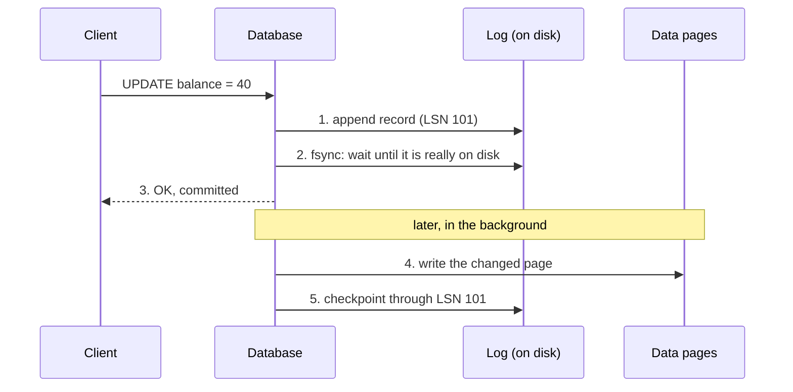

# The Log Is the Truth

*Write-ahead logging, from databases to AI agents. Architect Playbook, concept c01.*

## 1. The AI problem it prevents

A support agent handles a refund in four steps. It asks an LLM to plan the refund, calls the payment API
to refund $40, emails the customer, and asks the LLM for a ticket summary. The payment API takes eight
seconds to answer. During those eight seconds, the pod running the agent is evicted. The bank processes
the refund, but the agent never hears back.

The task is retried. The agent remembers nothing, so it starts over: it pays for the planning call again
and **refunds the customer a second time**. Nothing logs an error. At ten thousand runs a day, a rare
eviction turns into a steady leak.

This is an old problem. A database that crashes in the middle of a write asks the same question: *after a
restart, how do I know what already happened?* Databases answered it decades ago with the **write-ahead
log**.

## 2. Intuition

Picture a bank teller before computers. They never change an account card first. They write the
transaction in a journal ("10:42, account 17, +$40"), and only then update the card. If they faint
halfway, the next teller reads the journal and finishes the job. The journal is only ever appended to.
The cards can always be rebuilt from it.

That gives three rules: **write the intent first**, **only append**, and **the log is the truth**.
Everything else is a copy that can be rebuilt.

The analogy breaks in one place. Paper doesn't lie about whether the ink is dry. Computers do.



## 3. Mechanics, step by step

1. **Build a record:** a header holding the length, a checksum, and a log sequence number (LSN, an
   ever-increasing position in the log), plus a payload describing the change.
2. **Append it** to the end of the log. Appends are sequential, which makes them the cheapest write a
   disk can do.
3. **`fsync` it.** `write()` only copies bytes into the operating system's page cache, in RAM. `fsync`
   forces them onto the device and returns when they are durable. *This* is the moment of durability.
4. **Then acknowledge.** The order is the whole contract: log durable first, then "committed".
5. **Update the data pages lazily.** The changed page stays "dirty" in memory and is written later in
   batches. The log already holds everything needed to redo it.
6. **Checkpoint** now and then: write the dirty pages, record "pages are current through LSN N", and
   recycle older log segments.
7. **Recover after a crash:** start at the last checkpoint and redo each record. Stop at the first record
   that is too short or fails its checksum. That is the **torn tail**, a write that was never
   acknowledged. Cut it off and carry on.

Real systems add **group commit**, where many commits share one `fsync`, and **undo** information so they
can safely write uncommitted pages early. ARIES (1992) is the classic design that does both.

## 4. Break it

The lab gives a fake disk that loses power after byte *N*, and tries **every** *N* across a 7-write
workload.

```
naive: 634 of 664 crash points lose acked data; worst: crash at byte 514 loses 6 of 6 acked keys
wal:   0 of 230 crash points lose acked data
```

The naive store "saves" by truncating its file and writing the new state. Between those two calls, the
old state is gone and the new one doesn't exist yet. Almost every crash point lands in that window. The
WAL store only appends, so a crash can only cost the one write nobody was told succeeded.

Other ways it fails in production:

- **Ack before durable.** The code acknowledges after `write()`, or runs with `fsync` turned off.
  Committed data disappears after a crash.
- **A lying device.** A drive cache without power-loss protection acknowledges flushes it never
  performed.
- **Mishandled `fsync` errors.** See the first incident below.
- **Corruption in the middle of the log**, not at the tail. That is an alarm, not a normal crash
  artifact.
- **The log outgrows its checkpoints.** The disk fills and restarts take longer and longer.

## 5. Real incidents

**PostgreSQL "fsyncgate" (2018).** PostgreSQL assumed that if `fsync` failed, a later `fsync` that
succeeded meant the data was safe. On Linux, a failed writeback can drop the dirty pages, so the retry
"succeeds" with nothing on disk. The durability point wasn't where everyone believed. PostgreSQL now
**crashes on `fsync` failure** and replays its WAL, which is still intact.
[LWN](https://lwn.net/Articles/752063/)

**GitLab.com (January 2017).** A replica fell behind, and the WAL segments it needed had already been
recycled on the primary, so it had to be rebuilt from scratch. During that work, a command meant for the
replica wiped the primary's data. The backups had been failing silently, and about six hours of data was
lost. WAL retention is a capacity decision, and a WAL only protects you if it is archived somewhere you
can restore from.
[Postmortem](https://about.gitlab.com/blog/2017/02/10/postmortem-of-database-outage-of-january-31/)

## 6. Tradeoffs and where it is used

You pay with **write amplification** (every change is written at least twice), **commit latency** (the
`fsync`), and a tension between **recovery time** and **checkpoint cost**.

| Approach | Wins when | Used by |
|---|---|---|
| Write-ahead log | General purpose, many small writes | PostgreSQL, SQLite (WAL mode), etcd |
| Copy-on-write | Read-heavy workloads, instant recovery | LMDB, ZFS |
| The log *is* the database | Write-heavy workloads, streams | LSM stores, Kafka |
| Replicate instead of fsync | Machine failures are independent | Kafka's default |

It is the wrong tool for data you can recompute or afford to lose, such as caches and counters. It also
protects only one machine. Surviving the loss of the machine takes replication or an off-machine archive.

## 7. Apply it to agents

Give the agent a **step journal**:

```
intent  {run_id, step: 1, name: "refund", idempotency_key: "run-42:1"}
done    {run_id, step: 1, result: {"refund_id": "rf_881"}}
```

Append `intent`, perform the step, then append `done` with the **result**. On restart:

- **`done` exists:** skip the step and reuse the recorded result. There's no second LLM bill and no
  diverging answer.
- **Only `intent` exists:** the step *may* have happened. Retry it with the **same idempotency key**, so
  the payment API answers "already done".
- **No records:** run the step normally.

Crashed right after the refund, the naive agent ends with `refunds=2 llm_calls=3`. The journaled agent
ends with `refunds=1 llm_calls=2`, at every crash point. Remove the idempotency key and the in-flight
refund happens twice anyway. The journal tells you what *might* have happened. Only the other side can
tell you what *did*.

Temporal's event history and LangGraph's per-step checkpoints are this design. Now you can judge them:
where is the durability point, what gets recorded, and what happens to a side effect that was in flight?

> **For veterans:** databases can log *commands* because replaying them is deterministic. LLM calls
> aren't deterministic, so an agent journal must log *results*. It's the old logical-vs-physical logging
> split, back again. A framework that "resumes" by re-running the prompt has the bug.

## 8. Check yourself

1. `write()` returned success and the client got its ack. Then the power failed. Is the data safe?
2. Why is appending to a log cheaper than updating pages, even though everything is written twice?
3. A record in the *middle* of the log fails its checksum. Why is that different from a torn tail?
4. Why is crashing on an `fsync` error safer than retrying it?
5. Why should the agent journal store the LLM's output, not just the prompt?

**Design challenge:** journal a coding agent that edits files, runs tests, and opens a PR. "Open PR" has
no idempotency key. How do you make it safe to retry?

## If you remember three things

1. Data is durable when `fsync` returns, not when `write()` does. Acknowledge only after that.
2. Append, never overwrite. Then a crash can only damage the record being written.
3. For agents, journal the **results** of steps, and pair the journal with idempotency keys for side
   effects.

## Sources

OSTEP ch. 42 (Arpaci-Dusseau); SQLite *Write-Ahead Logging*; PostgreSQL docs *Reliability and the WAL*;
Mohan et al., *ARIES* (1992); LWN *PostgreSQL's fsync() surprise* (2018); Rebello et al., USENIX ATC 2020;
GitLab postmortem (2017); Pillai et al., OSDI 2014. Full links are in `notes.md`.

## Video outline

1. Cold open: the double refund, shown as a timeline (0:00–0:45)
2. The teller's journal analogy, with the sequence diagram (0:45–2:00)
3. `write()` vs `fsync`: animate bytes stuck in the page cache (2:00–3:30)
4. Live lab: slide the crash point, the naive store loses data, the WAL holds (3:30–5:30)
5. fsyncgate in 60 seconds (5:30–6:30)
6. The agent step journal and the refund-once proof (6:30–8:30)
7. Three things to remember, then the design challenge (8:30–9:30)
